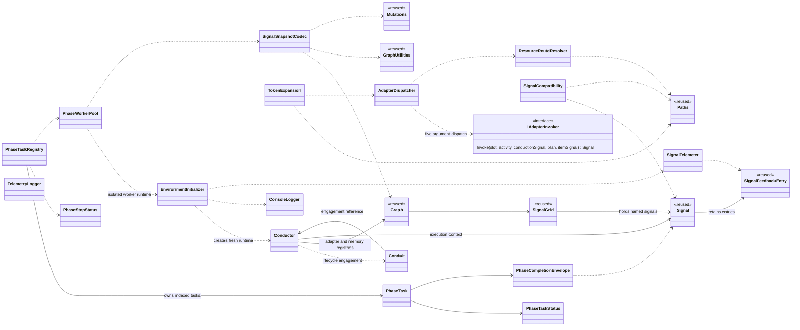
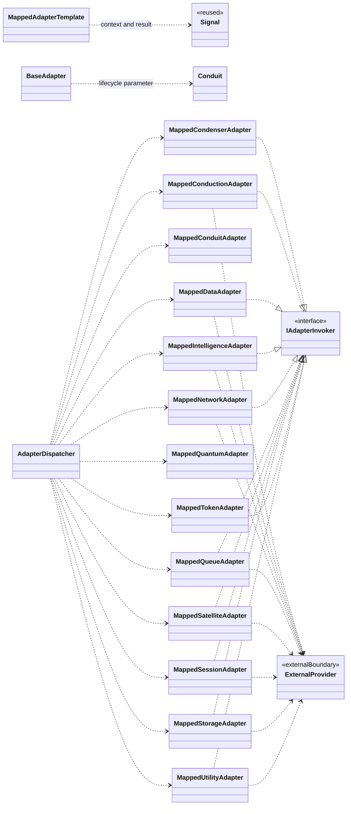
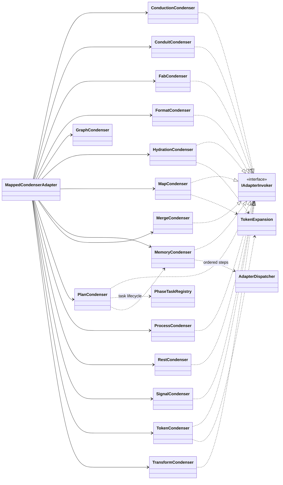
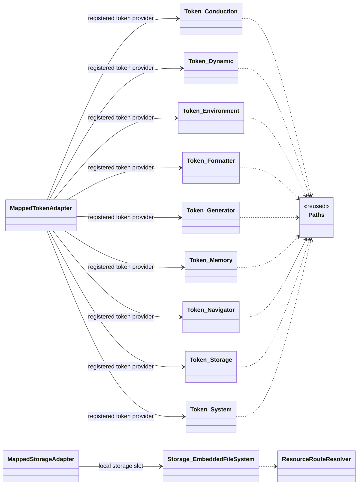

review  472951# C# Foundation class design — Phase 0

CS-DESIGN-00, 2026-11-12. Design artifact under the [port plan](ST-CSharp-Port-Plan.md), exact READY SHA-256 `206700274A499E5F193BC0DEA9DD9EF841590D6F8F603774424D97990BB9AAD1`. Proposed class names below are implementation targets, not existing C# functionality. No product code, build, runtime test, package or provider acceptance is delivered here. Lifecycle/review evidence belongs in [CSharp-Port-Working.md](Working/CSharp-Port-Working.md).

Foundation will reference the **current new C# SignalGraph project** at `C:/GitHub/SiliconDreamArtists/SignalGraph/Src/CSharp/SignalGraph.csproj` ([project](../../../SignalGraph/Src/CSharp/SignalGraph.csproj)). The future Foundation project is `Src/CSharp/Foundation/SovereignTrust.Foundation.csproj`; its project reference resolves `../../../../SignalGraph/Src/CSharp/SignalGraph.csproj`. Do not copy or reimplement SignalGraph types. The project is observed netstandard2.0, package ID SovereignTrust.SignalGraph, version 2.1.0; Foundation and the parity harness will target net10.0, with PowerShell 7.6.x wrappers; the existing netstandard2.0 dependency remains unchanged. This is a design dependency, not a verified build or permission to change the sibling project.

The SignalGraph project identity still matches the plan; current Signal.Parity.cs and Graph.cs identities differ from the earlier planning snapshot and current Paths/Mutations/GraphUtilities are inspected explicitly below. The coordinator/reviewer confirmed current-source inspection is within the design READY boundary. Current signatures establish reusable design surfaces only; Wave 1 must characterize actual semantics before dependent implementation. Earlier source identities and review history remain in the plan/Working record.

The supported wrapper baseline is PowerShell 7.6.x on .NET 10; do not claim all PowerShell 7.x or automatically accept later releases. For each claimed Windows, Linux and macOS combination, bind the supported OS/version/architecture from the official support matrix and capture the actual host/runtime/SDK. Acceptance requires assembly load/type resolution, shared live graph identity/mutation and selected-plan parity through the wrapper; verify path casing/separators, native process behavior, permissions and native dependencies. Declare platform-specific adapter exclusions explicitly (including Windows/NTFS-only AtomicFiles); unavailable checks block that platform support claim, not documentation or unrelated platform work. Later PowerShell/.NET releases require explicit compatibility tests before a support claim. [PowerShell 7.6 release notes](https://learn.microsoft.com/en-us/powershell/scripting/whats-new/what-s-new-in-powershell-76?view=powershell-7.6) identify .NET 10; use the [PowerShell support lifecycle](https://learn.microsoft.com/en-us/powershell/scripting/install/powershell-support-lifecycle?view=powershell-7.6) for supported host combinations, not an assumption that every OS release is supported.

## Class model

The connected views below are one model, split to keep names readable. Every short node name resolves uniquely to the namespace-qualified inventory below. Solid arrows are ownership/reference relationships; dashed arrows are dependencies. `..|>` denotes only the proposed C# dispatch interface, not inheritance claimed from PowerShell. Graph pointers/jackets are object references and can be cyclic; they are not a class hierarchy. ExternalProvider is a boundary marker, not a class to implement.

## Inventory conventions

All `SovereignTrust.Foundation.*` entries in the implementation tables are proposed new C# types. Wave numbers match the reviewed plan: 1 harness; 2 runtime/routing; 3 values/tokens; 4 serial execution/local bootstrap; 5 tasks/process/HTTP; 6 full Foundation conformance; 7 provider compatibility; 8 adoption. A range denotes initial implementation followed by completion, not permission to defer a prerequisite assertion. These names preserve recognizable source classes; underscores in built-in token/storage names are intentional source correspondence.

No unsupported activity becomes implemented merely because its containing class appears. Interface implementation applies only to source-compatible five-argument Invoke routes; BaseAdapter, MappedAdapterTemplate, MappedConduitAdapter, MappedQuantumAdapter and GraphCondenser retain their distinct source entry points. Methods for wrappers/helpers live on the listed owning types; there is no class per function, no new plugin framework and no invented common BaseAdapter inheritance.

The mechanically reconciled implementation inventory and catalog views follow. There are 57 proposed classes and one proposed interface; all 28 primary catalog owners have exactly one named class. The tables define responsibility boundaries, not a public API signature freeze. Methods and receipt fields follow source contracts during implementation; any consequential incompatibility stops its dependent wave.

| Proposed namespace-qualified type | Target path under Src/CSharp/Foundation/ | Responsibility | Source / catalog | Relationships / dependencies | Wave |
| --- | --- | --- | --- | --- | --- |
| `SovereignTrust.Foundation.Classes.Conduction.Conductor` | `Classes/Conduction/Conductor.cs` | Own adapter/memory graphs, registered native type/factory creation, hydration, optional Construct and eager/lazy resolution/registration; no automatic listener start. | [Conductor.ps1](../../Src/PowerShell/Classes/Conduction/Conductor.ps1) | Signal, Graph, mapped families | 2–6 |
| `SovereignTrust.Foundation.Classes.Conduction.Conduit` | `Classes/Conduction/Conduit.cs` | Retain identifier/type, Context/Feedback, running state, conductor engagement and Start/Complete lifecycle; ExecutePhase remains unfinished and unsupported, not dispatch. | [Conduit.ps1](../../Src/PowerShell/Classes/Conduction/Conduit.ps1) | Conductor; retained Context/Feedback and lifecycle state | 2–6 |
| `SovereignTrust.Foundation.Utilities.Conduction.EnvironmentInitializer` | `Utilities/Conduction/EnvironmentInitializer.cs` | Static initialization entry point; fresh cloned environment, logger setup and runtime result. | [Initialize-STEnvironment.ps1](../../Src/PowerShell/Utilities/Conduction/Initialize-STEnvironment.ps1) | Conductor, ConsoleLogger, SignalTelemeter | 2 |
| `SovereignTrust.Foundation.Wrappers.Adapters.AdapterDispatcher` | `Wrappers/Adapters/AdapterDispatcher.cs` | Own invocation wrappers/core; request lazy resolution from Conductor then forward five-argument context to the selected instance. | [Invoke-MappedAdapter.ps1](../../Src/PowerShell/Wrappers/Adapters/Invoke-MappedAdapter.ps1) | IAdapterInvoker, Conductor, ResourceRouteResolver | 2 |
| `SovereignTrust.Foundation.Utilities.Json.SignalCompatibility` | `Utilities/Json/SignalCompatibility.cs` | Small method/property and no-Signal adapter bridge only; delegate graph/path/severity logic to SignalGraph. | [Resolve-PathFromDictionaryNoSignal.ps1](../../Src/PowerShell/Utilities/Json/Resolve-PathFromDictionaryNoSignal.ps1) | Signal, Paths | 1–3 |
| `SovereignTrust.Foundation.Utilities.Adapters.Storage.ResourceRouteResolver` | `Utilities/Adapters/Storage/ResourceRouteResolver.cs` | Own storage and remaining-family route helper methods, preserving resource/binding guards. | [Resolve-StorageResourceRoutesJacket.ps1](../../Src/PowerShell/Utilities/Adapters/Storage/Resolve-StorageResourceRoutesJacket.ps1) | Paths, AdapterDispatcher | 4–6 |
| `SovereignTrust.Foundation.Utilities.Adapters.Condenser.Token.TokenExpansion` | `Utilities/Adapters/Condenser/Token/TokenExpansion.cs` | Own shared token parse/substitution helper methods used by Map/Hydration/Token; preserve evaluation order. | [Invoke-HydrateTokenCondenser.ps1](../../Src/PowerShell/Utilities/Adapters/Condenser/Token/Invoke-HydrateTokenCondenser.ps1) | Paths, AdapterDispatcher | 3 |
| `SovereignTrust.Foundation.Utilities.Threading.PhaseTaskRegistry` | `Utilities/Threading/PhaseTaskRegistry.cs` | Own task registration, status/receive/wait/stop and completion-envelope lifecycle; no new durability guarantee. | [STBackgroundTasks.ps1](../../Src/PowerShell/Utilities/Threading/STBackgroundTasks.ps1) | PhaseTask, PhaseWorkerPool, PhaseTaskStatus, PhaseStopStatus | 5 |
| `SovereignTrust.Foundation.Utilities.Threading.PhaseTask` | `Utilities/Threading/PhaseTask.cs` | Typed internal task record retaining owner, identity, state, timestamps, worker handle and completion. | [STBackgroundTasks.ps1](../../Src/PowerShell/Utilities/Threading/STBackgroundTasks.ps1) | PhaseTaskStatus, PhaseCompletionEnvelope | 5 |
| `SovereignTrust.Foundation.Utilities.Threading.PhaseTaskStatus` | `Utilities/Threading/PhaseTaskStatus.cs` | Typed status projection with source TaskId/TaskName/OwnerId/State and timestamps; not a Signal replacement. | [STBackgroundTasks.ps1](../../Src/PowerShell/Utilities/Threading/STBackgroundTasks.ps1) | PhaseTask | 5 |
| `SovereignTrust.Foundation.Utilities.Threading.PhaseStopStatus` | `Utilities/Threading/PhaseStopStatus.cs` | Typed stop receipt with prior state, stop requested/completed, closed-worker and terminal observations. | [STBackgroundTasks.ps1](../../Src/PowerShell/Utilities/Threading/STBackgroundTasks.ps1) | PhaseTaskStatus | 5 |
| `SovereignTrust.Foundation.Utilities.Threading.PhaseCompletionEnvelope` | `Utilities/Threading/PhaseCompletionEnvelope.cs` | Typed worker completion payload retaining initialization/worker Signals, Failed/Error and graph records. | [Complete-PlanPhaseTask.ps1](../../Src/PowerShell/Utilities/Adapters/Condenser/Plan/Complete-PlanPhaseTask.ps1) | Signal, SignalSnapshotCodec | 5 |
| `SovereignTrust.Foundation.Utilities.Threading.PhaseWorkerPool` | `Utilities/Threading/PhaseWorkerPool.cs` | Bounded native C# worker execution preserving input-index result order and isolated runtimes. | [Invoke-STRunspacePool.ps1](../../Src/PowerShell/Utilities/Threading/Invoke-STRunspacePool.ps1) | EnvironmentInitializer, PhaseCompletionEnvelope | 5 |
| `SovereignTrust.Foundation.Utilities.Graph.SignalSnapshotCodec` | `Utilities/Graph/SignalSnapshotCodec.cs` | Own export/import and signal-record conversion methods; preserve tested snapshot/merge collision semantics, not a competing Graph serializer. | [Export-STSignalGraphSnapshot.ps1](../../Src/PowerShell/Utilities/Graph/Export-STSignalGraphSnapshot.ps1) | Graph, Signal, GraphUtilities, Mutations | 5 |
| `SovereignTrust.Foundation.Classes.Adapters.Telemetry.ConsoleLogger` | `Classes/Adapters/Telemetry/ConsoleLogger.cs` | Retain local console/entry logging contract as methods; no provider telemetry calls or global model replacement. | [ConsoleLogger.ps1](../../Src/PowerShell/Classes/Adapters/Telemetry/ConsoleLogger.ps1) | SignalFeedbackEntry, Signal | 2–6 |
| `SovereignTrust.Foundation.Classes.Adapters.Telemetry.TelemetryLogger` | `Classes/Adapters/Telemetry/TelemetryLogger.cs` | Retain local console/entry logging contract as methods; no provider telemetry calls or global model replacement. | [TelemetryLogger.ps1](../../Src/PowerShell/Classes/Adapters/Telemetry/TelemetryLogger.ps1) | SignalFeedbackEntry, Signal | 2–6 |
| `SovereignTrust.Foundation.Classes.Adapters.Telemetry.SignalTelemeter` | `Classes/Adapters/Telemetry/SignalTelemeter.cs` | Retain local console/entry logging contract as methods; no provider telemetry calls or global model replacement. | [SignalTelemeter.ps1](../../Src/PowerShell/Classes/Adapters/Telemetry/SignalTelemeter.ps1) | SignalFeedbackEntry, Signal | 2–6 |
| `SovereignTrust.Foundation.Classes.Adapters.BaseAdapter` | `Classes/Adapters/BaseAdapter.cs` | Retain named Start/Stop lifecycle entry points for consumers; no Invoke method and no inferred subclass tree. | [BaseAdapter.ps1](../../Src/PowerShell/Classes/Adapters/BaseAdapter.ps1) | Conduit | 6 |
| `SovereignTrust.Foundation.Classes.Adapters.MappedAdapterTemplate` | `Classes/Adapters/MappedAdapterTemplate.cs` | Retain source-only registration/three-argument invocation template, distinct from mapped Activity routes. | [MappedAdapterTemplate.ps1](../../Src/PowerShell/Classes/Adapters/MappedAdapterTemplate.ps1) | Signal, Conductor | 6 |
| `SovereignTrust.Foundation.Wrappers.Adapters.IAdapterInvoker` | `Wrappers/Adapters/IAdapterInvoker.cs` | Proposed interface, not class: Invoke(slot,activity,conductionSignal,plan,itemSignal) returns shared Signal; narrow injected-provider boundary. | [Invoke-MappedAdapter.ps1](../../Src/PowerShell/Wrappers/Adapters/Invoke-MappedAdapter.ps1) | Signal | 2 |
| `SovereignTrust.Foundation.Classes.Adapters.MappedCondenserAdapter` | `Classes/Adapters/MappedCondenserAdapter.cs` | Family-specific registration, validation and routing; preserve each activity/context contract. | [MappedCondenserAdapter.ps1](../../Src/PowerShell/Classes/Adapters/MappedCondenserAdapter.ps1); [MappedCondenserAdapter](../../Src/PowerShell/Classes/Adapters/Catalog/Mapped/MappedCondenserAdapter.json) | Conductor, Signal, AdapterDispatcher; selected concrete provider | 2–6 |
| `SovereignTrust.Foundation.Classes.Adapters.MappedConductionAdapter` | `Classes/Adapters/MappedConductionAdapter.cs` | Family-specific registration, validation and routing; preserve each activity/context contract. | [MappedConductionAdapter.ps1](../../Src/PowerShell/Classes/Adapters/MappedConductionAdapter.ps1); [MappedConductionAdapter](../../Src/PowerShell/Classes/Adapters/Catalog/Mapped/MappedConductionAdapter.json) | Conductor, Signal, AdapterDispatcher; selected concrete provider | 2–6 |
| `SovereignTrust.Foundation.Classes.Adapters.MappedConduitAdapter` | `Classes/Adapters/MappedConduitAdapter.cs` | Family-specific registration, validation and routing; preserve each activity/context contract. | [MappedConduitAdapter.ps1](../../Src/PowerShell/Classes/Adapters/MappedConduitAdapter.ps1); [MappedConduitAdapter](../../Src/PowerShell/Classes/Adapters/Catalog/Mapped/MappedConduitAdapter.json) | Conductor, Signal, AdapterDispatcher; selected concrete provider | 2–6 |
| `SovereignTrust.Foundation.Classes.Adapters.MappedDataAdapter` | `Classes/Adapters/MappedDataAdapter.cs` | Family-specific registration, validation and routing; preserve each activity/context contract. | [MappedDataAdapter.ps1](../../Src/PowerShell/Classes/Adapters/MappedDataAdapter.ps1); [MappedDataAdapter](../../Src/PowerShell/Classes/Adapters/Catalog/Mapped/MappedDataAdapter.json) | Conductor, Signal, AdapterDispatcher; selected concrete provider | 2–6 |
| `SovereignTrust.Foundation.Classes.Adapters.MappedIntelligenceAdapter` | `Classes/Adapters/MappedIntelligenceAdapter.cs` | Family-specific registration, validation and routing; preserve each activity/context contract. | [MappedIntelligenceAdapter.ps1](../../Src/PowerShell/Classes/Adapters/MappedIntelligenceAdapter.ps1); [MappedIntelligenceAdapter](../../Src/PowerShell/Classes/Adapters/Catalog/Mapped/MappedIntelligenceAdapter.json) | Conductor, Signal, AdapterDispatcher; selected concrete provider | 2–6 |
| `SovereignTrust.Foundation.Classes.Adapters.MappedNetworkAdapter` | `Classes/Adapters/MappedNetworkAdapter.cs` | Family-specific registration, validation and routing; preserve each activity/context contract. | [MappedNetworkAdapter.ps1](../../Src/PowerShell/Classes/Adapters/MappedNetworkAdapter.ps1); [MappedNetworkAdapter](../../Src/PowerShell/Classes/Adapters/Catalog/Mapped/MappedNetworkAdapter.json) | Conductor, Signal, AdapterDispatcher; selected concrete provider | 2–6 |
| `SovereignTrust.Foundation.Classes.Adapters.MappedQuantumAdapter` | `Classes/Adapters/MappedQuantumAdapter.cs` | Family-specific registration, validation and routing; preserve each activity/context contract. | [MappedQuantumAdapter.ps1](../../Src/PowerShell/Classes/Adapters/MappedQuantumAdapter.ps1); [MappedQuantumAdapter](../../Src/PowerShell/Classes/Adapters/Catalog/Mapped/MappedQuantumAdapter.json) | Conductor, Signal, AdapterDispatcher; selected concrete provider | 2–6 |
| `SovereignTrust.Foundation.Classes.Adapters.MappedQueueAdapter` | `Classes/Adapters/MappedQueueAdapter.cs` | Family-specific registration, validation and routing; preserve each activity/context contract. | [MappedQueueAdapter.ps1](../../Src/PowerShell/Classes/Adapters/MappedQueueAdapter.ps1); [MappedQueueAdapter](../../Src/PowerShell/Classes/Adapters/Catalog/Mapped/MappedQueueAdapter.json) | Conductor, Signal, AdapterDispatcher; selected concrete provider | 2–6 |
| `SovereignTrust.Foundation.Classes.Adapters.MappedSatelliteAdapter` | `Classes/Adapters/MappedSatelliteAdapter.cs` | Family-specific registration, validation and routing; preserve each activity/context contract. | [MappedSatelliteAdapter.ps1](../../Src/PowerShell/Classes/Adapters/MappedSatelliteAdapter.ps1); [MappedSatelliteAdapter](../../Src/PowerShell/Classes/Adapters/Catalog/Mapped/MappedSatelliteAdapter.json) | Conductor, Signal, AdapterDispatcher; selected concrete provider | 2–6 |
| `SovereignTrust.Foundation.Classes.Adapters.MappedSessionAdapter` | `Classes/Adapters/MappedSessionAdapter.cs` | Family-specific registration, validation and routing; preserve each activity/context contract. | [MappedSessionAdapter.ps1](../../Src/PowerShell/Classes/Adapters/MappedSessionAdapter.ps1); [MappedSessionAdapter](../../Src/PowerShell/Classes/Adapters/Catalog/Mapped/MappedSessionAdapter.json) | Conductor, Signal, AdapterDispatcher; selected concrete provider | 2–6 |
| `SovereignTrust.Foundation.Classes.Adapters.MappedStorageAdapter` | `Classes/Adapters/MappedStorageAdapter.cs` | Family-specific registration, validation and routing; preserve each activity/context contract. | [MappedStorageAdapter.ps1](../../Src/PowerShell/Classes/Adapters/MappedStorageAdapter.ps1); [MappedStorageAdapter](../../Src/PowerShell/Classes/Adapters/Catalog/Mapped/MappedStorageAdapter.json) | Conductor, Signal, AdapterDispatcher; selected concrete provider; Storage_EmbeddedFileSystem | 2–6 |
| `SovereignTrust.Foundation.Classes.Adapters.MappedTokenAdapter` | `Classes/Adapters/MappedTokenAdapter.cs` | Family-specific registration, validation and routing; preserve each activity/context contract. | [MappedTokenAdapter.ps1](../../Src/PowerShell/Classes/Adapters/MappedTokenAdapter.ps1); [MappedTokenAdapter](../../Src/PowerShell/Classes/Adapters/Catalog/Mapped/MappedTokenAdapter.json) | Conductor, Signal, AdapterDispatcher; selected concrete provider; nine built-in token classes | 2–6 |
| `SovereignTrust.Foundation.Classes.Adapters.MappedUtilityAdapter` | `Classes/Adapters/MappedUtilityAdapter.cs` | Family-specific registration, validation and routing; preserve each activity/context contract. | [MappedUtilityAdapter.ps1](../../Src/PowerShell/Classes/Adapters/MappedUtilityAdapter.ps1); [MappedUtilityAdapter](../../Src/PowerShell/Classes/Adapters/Catalog/Mapped/MappedUtilityAdapter.json) | Conductor, Signal, AdapterDispatcher; selected concrete provider | 2–6 |
| `SovereignTrust.Foundation.Classes.Adapters.Condenser.ConductionCondenser` | `Classes/Adapters/Condenser/ConductionCondenser.cs` | Own ST, Sleep dispatch and helper methods; retain per-activity failure/result contracts. | [ConductionCondenser.ps1](../../Src/PowerShell/Classes/Adapters/Condenser/ConductionCondenser.ps1); [ConductionCondenser](../../Src/PowerShell/Classes/Adapters/Catalog/Condensers/ConductionCondenser.json) | Signal, Conductor, mapped condenser registry | 6 |
| `SovereignTrust.Foundation.Classes.Adapters.Condenser.ConduitCondenser` | `Classes/Adapters/Condenser/ConduitCondenser.cs` | Own Process, Graph dispatch and helper methods; retain per-activity failure/result contracts. | [ConduitCondenser.ps1](../../Src/PowerShell/Classes/Adapters/Condenser/ConduitCondenser.ps1); [ConduitCondenser](../../Src/PowerShell/Classes/Adapters/Catalog/Condensers/ConduitCondenser.json) | Signal, Conductor, mapped condenser registry | 6 |
| `SovereignTrust.Foundation.Classes.Adapters.Condenser.FabCondenser` | `Classes/Adapters/Condenser/FabCondenser.cs` | Own Invoke, ObserveMappedAdapter dispatch and helper methods; retain per-activity failure/result contracts. | [FabCondenser.ps1](../../Src/PowerShell/Classes/Adapters/Condenser/FabCondenser.ps1); [FabCondenser](../../Src/PowerShell/Classes/Adapters/Catalog/Condensers/FabCondenser.json) | Signal, Conductor, mapped condenser registry | 2–6 |
| `SovereignTrust.Foundation.Classes.Adapters.Condenser.FormatCondenser` | `Classes/Adapters/Condenser/FormatCondenser.cs` | Own Json, JsonArray, Xml, Text dispatch and helper methods; retain per-activity failure/result contracts. | [FormatCondenser.ps1](../../Src/PowerShell/Classes/Adapters/Condenser/FormatCondenser.ps1); [FormatCondenser](../../Src/PowerShell/Classes/Adapters/Catalog/Condensers/FormatCondenser.json) | Signal, Conductor, mapped condenser registry | 3 |
| `SovereignTrust.Foundation.Classes.Adapters.Condenser.GraphCondenser` | `Classes/Adapters/Condenser/GraphCondenser.cs` | Source-only two-argument graph launch; no declared mapped activity. | [GraphCondenser.ps1](../../Src/PowerShell/Classes/Adapters/Condenser/GraphCondenser.ps1); [GraphCondenser](../../Src/PowerShell/Classes/Adapters/Catalog/Condensers/GraphCondenser.json) | Signal, Conductor, mapped condenser registry | 6 |
| `SovereignTrust.Foundation.Classes.Adapters.Condenser.HydrationCondenser` | `Classes/Adapters/Condenser/HydrationCondenser.cs` | Own Invoke dispatch and helper methods; retain per-activity failure/result contracts. | [HydrationCondenser.ps1](../../Src/PowerShell/Classes/Adapters/Condenser/HydrationCondenser.ps1); [HydrationCondenser](../../Src/PowerShell/Classes/Adapters/Catalog/Condensers/HydrationCondenser.json) | Signal, Conductor, mapped condenser registry; TokenExpansion | 3 |
| `SovereignTrust.Foundation.Classes.Adapters.Condenser.MapCondenser` | `Classes/Adapters/Condenser/MapCondenser.cs` | Own Invoke, Map dispatch and helper methods; retain per-activity failure/result contracts. | [MapCondenser.ps1](../../Src/PowerShell/Classes/Adapters/Condenser/MapCondenser.ps1); [MapCondenser](../../Src/PowerShell/Classes/Adapters/Catalog/Condensers/MapCondenser.json) | Signal, Conductor, mapped condenser registry; TokenExpansion | 3 |
| `SovereignTrust.Foundation.Classes.Adapters.Condenser.MemoryCondenser` | `Classes/Adapters/Condenser/MemoryCondenser.cs` | Own Persist, Generate dispatch and helper methods; retain per-activity failure/result contracts. | [MemoryCondenser.ps1](../../Src/PowerShell/Classes/Adapters/Condenser/MemoryCondenser.ps1); [MemoryCondenser](../../Src/PowerShell/Classes/Adapters/Catalog/Condensers/MemoryCondenser.json) | Signal, Conductor, mapped condenser registry; AdapterDispatcher, TokenExpansion | 4–6 |
| `SovereignTrust.Foundation.Classes.Adapters.Condenser.MergeCondenser` | `Classes/Adapters/Condenser/MergeCondenser.cs` | Own Merge dispatch and helper methods; retain per-activity failure/result contracts. | [MergeCondenser.ps1](../../Src/PowerShell/Classes/Adapters/Condenser/MergeCondenser.ps1); [MergeCondenser](../../Src/PowerShell/Classes/Adapters/Catalog/Condensers/MergeCondenser.json) | Signal, Conductor, mapped condenser registry | 3 |
| `SovereignTrust.Foundation.Classes.Adapters.Condenser.PlanCondenser` | `Classes/Adapters/Condenser/PlanCondenser.cs` | Own IteratePhase, InvokePlan, InvokePhase, InvokePhaseAsync, AwaitPhase, AwaitAllPhases, GetPhaseStatus, StopPhase, InsertPhaseSteps, AddPhaseSteps dispatch and helper methods; retain per-activity failure/result contracts. | [PlanCondenser.ps1](../../Src/PowerShell/Classes/Adapters/Condenser/PlanCondenser.ps1); [PlanCondenser](../../Src/PowerShell/Classes/Adapters/Catalog/Condensers/PlanCondenser.json) | Signal, Conductor, mapped condenser registry; PhaseTaskRegistry, SignalSnapshotCodec | 4–6 |
| `SovereignTrust.Foundation.Classes.Adapters.Condenser.ProcessCondenser` | `Classes/Adapters/Condenser/ProcessCondenser.cs` | Own Run dispatch and helper methods; retain per-activity failure/result contracts. | [ProcessCondenser.ps1](../../Src/PowerShell/Classes/Adapters/Condenser/ProcessCondenser.ps1); [ProcessCondenser](../../Src/PowerShell/Classes/Adapters/Catalog/Condensers/ProcessCondenser.json) | Signal, Conductor, mapped condenser registry | 5 |
| `SovereignTrust.Foundation.Classes.Adapters.Condenser.RestCondenser` | `Classes/Adapters/Condenser/RestCondenser.cs` | Own Get, Head, Post, Put, Patch, Delete, Options dispatch and helper methods; retain per-activity failure/result contracts. | [RestCondenser.ps1](../../Src/PowerShell/Classes/Adapters/Condenser/RestCondenser.ps1); [RestCondenser](../../Src/PowerShell/Classes/Adapters/Catalog/Condensers/RestCondenser.json) | Signal, Conductor, mapped condenser registry | 5 |
| `SovereignTrust.Foundation.Classes.Adapters.Condenser.SignalCondenser` | `Classes/Adapters/Condenser/SignalCondenser.cs` | Own Log, Assert dispatch and helper methods; retain per-activity failure/result contracts. | [SignalCondenser.ps1](../../Src/PowerShell/Classes/Adapters/Condenser/SignalCondenser.ps1); [SignalCondenser](../../Src/PowerShell/Classes/Adapters/Catalog/Condensers/SignalCondenser.json) | Signal, Conductor, mapped condenser registry | 3 |
| `SovereignTrust.Foundation.Classes.Adapters.Condenser.TokenCondenser` | `Classes/Adapters/Condenser/TokenCondenser.cs` | Own Parse dispatch and helper methods; retain per-activity failure/result contracts. | [TokenCondenser.ps1](../../Src/PowerShell/Classes/Adapters/Condenser/TokenCondenser.ps1); [TokenCondenser](../../Src/PowerShell/Classes/Adapters/Catalog/Condensers/TokenCondenser.json) | Signal, Conductor, mapped condenser registry; TokenExpansion | 3 |
| `SovereignTrust.Foundation.Classes.Adapters.Condenser.TransformCondenser` | `Classes/Adapters/Condenser/TransformCondenser.cs` | Own Project, Select, Inject, RegisterSignal, UnregisterSignalKeys, Clone, Merge dispatch and helper methods; retain per-activity failure/result contracts. | [TransformCondenser.ps1](../../Src/PowerShell/Classes/Adapters/Condenser/TransformCondenser.ps1); [TransformCondenser](../../Src/PowerShell/Classes/Adapters/Catalog/Condensers/TransformCondenser.json) | Signal, Conductor, mapped condenser registry | 3 |
| `SovereignTrust.Foundation.Classes.Adapters.Token.Token_Conduction` | `Classes/Adapters/Token/Token_Conduction.cs` | Built-in Conduction token dispatch and associated Utilities/Adapters/Token methods; retain native values and source effects. | [Token_Conduction.ps1](../../Src/PowerShell/Classes/Adapters/Token/Token_Conduction.ps1) | Signal, Paths; mapped adapter boundary for storage/conduction | 3 |
| `SovereignTrust.Foundation.Classes.Adapters.Token.Token_Dynamic` | `Classes/Adapters/Token/Token_Dynamic.cs` | Built-in Dynamic token dispatch and associated Utilities/Adapters/Token methods; retain native values and source effects. | [Token_Dynamic.ps1](../../Src/PowerShell/Classes/Adapters/Token/Token_Dynamic.ps1) | Signal, Paths; mapped adapter boundary for storage/conduction | 3 |
| `SovereignTrust.Foundation.Classes.Adapters.Token.Token_Environment` | `Classes/Adapters/Token/Token_Environment.cs` | Built-in Environment token dispatch and associated Utilities/Adapters/Token methods; retain native values and source effects. | [Token_Environment.ps1](../../Src/PowerShell/Classes/Adapters/Token/Token_Environment.ps1) | Signal, Paths; mapped adapter boundary for storage/conduction | 3 |
| `SovereignTrust.Foundation.Classes.Adapters.Token.Token_Formatter` | `Classes/Adapters/Token/Token_Formatter.cs` | Built-in Formatter token dispatch and associated Utilities/Adapters/Token methods; retain native values and source effects. | [Token_Formatter.ps1](../../Src/PowerShell/Classes/Adapters/Token/Token_Formatter.ps1) | Signal, Paths; mapped adapter boundary for storage/conduction | 3 |
| `SovereignTrust.Foundation.Classes.Adapters.Token.Token_Generator` | `Classes/Adapters/Token/Token_Generator.cs` | Built-in Generator token dispatch and associated Utilities/Adapters/Token methods; retain native values and source effects. | [Token_Generator.ps1](../../Src/PowerShell/Classes/Adapters/Token/Token_Generator.ps1) | Signal, Paths; mapped adapter boundary for storage/conduction | 3 |
| `SovereignTrust.Foundation.Classes.Adapters.Token.Token_Memory` | `Classes/Adapters/Token/Token_Memory.cs` | Built-in Memory token dispatch and associated Utilities/Adapters/Token methods; retain native values and source effects. | [Token_Memory.ps1](../../Src/PowerShell/Classes/Adapters/Token/Token_Memory.ps1) | Signal, Paths; mapped adapter boundary for storage/conduction | 3 |
| `SovereignTrust.Foundation.Classes.Adapters.Token.Token_Navigator` | `Classes/Adapters/Token/Token_Navigator.cs` | Built-in Navigator token dispatch and associated Utilities/Adapters/Token methods; retain native values and source effects. | [Token_Navigator.ps1](../../Src/PowerShell/Classes/Adapters/Token/Token_Navigator.ps1) | Signal, Paths; mapped adapter boundary for storage/conduction | 3 |
| `SovereignTrust.Foundation.Classes.Adapters.Token.Token_Storage` | `Classes/Adapters/Token/Token_Storage.cs` | Built-in Storage token dispatch and associated Utilities/Adapters/Token methods; retain native values and source effects. | [Token_Storage.ps1](../../Src/PowerShell/Classes/Adapters/Token/Token_Storage.ps1) | Signal, Paths; mapped adapter boundary for storage/conduction | 3 |
| `SovereignTrust.Foundation.Classes.Adapters.Token.Token_System` | `Classes/Adapters/Token/Token_System.cs` | Built-in System token dispatch and associated Utilities/Adapters/Token methods; retain native values and source effects. | [Token_System.ps1](../../Src/PowerShell/Classes/Adapters/Token/Token_System.ps1) | Signal, Paths; mapped adapter boundary for storage/conduction | 3 |
| `SovereignTrust.Foundation.Classes.Adapters.Storage.Storage_EmbeddedFileSystem` | `Classes/Adapters/Storage/Storage_EmbeddedFileSystem.cs` | Local content/filesystem operations and source/target path guards; no AtomicFiles publication substitution. | [Storage_EmbeddedFileSystem.ps1](../../Src/PowerShell/Classes/Adapters/Storage/Storage_EmbeddedFileSystem.ps1) | Signal, ResourceRouteResolver | 4 |

### Catalog dispatch view

### Condenser registration view

### Built-in token and storage view

## Primary catalog reconciliation

| Owner | Proposed C# type | Declared activity count | Coverage disposition |
| --- | --- | --- | --- |
| MappedCondenserAdapter | `SovereignTrust.Foundation.Classes.Adapters.MappedCondenserAdapter` | 0 | Empty mapped inventory; retain source-only route separately, no invented Activity. |
| MappedConductionAdapter | `SovereignTrust.Foundation.Classes.Adapters.MappedConductionAdapter` | 3 | All declared labels accounted by owning class; complete source-specific behavior and unsupported assertions in assigned waves. |
| MappedConduitAdapter | `SovereignTrust.Foundation.Classes.Adapters.MappedConduitAdapter` | 0 | Empty mapped inventory; retain source-only route separately, no invented Activity. |
| MappedDataAdapter | `SovereignTrust.Foundation.Classes.Adapters.MappedDataAdapter` | 26 | All declared labels accounted by owning class; complete source-specific behavior and unsupported assertions in assigned waves. |
| MappedIntelligenceAdapter | `SovereignTrust.Foundation.Classes.Adapters.MappedIntelligenceAdapter` | 2 | All declared labels accounted by owning class; complete source-specific behavior and unsupported assertions in assigned waves. |
| MappedNetworkAdapter | `SovereignTrust.Foundation.Classes.Adapters.MappedNetworkAdapter` | 4 | All declared labels accounted by owning class; complete source-specific behavior and unsupported assertions in assigned waves. |
| MappedQuantumAdapter | `SovereignTrust.Foundation.Classes.Adapters.MappedQuantumAdapter` | 0 | Empty mapped inventory; retain source-only route separately, no invented Activity. |
| MappedQueueAdapter | `SovereignTrust.Foundation.Classes.Adapters.MappedQueueAdapter` | 6 | All declared labels accounted by owning class; complete source-specific behavior and unsupported assertions in assigned waves. |
| MappedSatelliteAdapter | `SovereignTrust.Foundation.Classes.Adapters.MappedSatelliteAdapter` | 5 | All declared labels accounted by owning class; complete source-specific behavior and unsupported assertions in assigned waves. |
| MappedSessionAdapter | `SovereignTrust.Foundation.Classes.Adapters.MappedSessionAdapter` | 1 | All declared labels accounted by owning class; complete source-specific behavior and unsupported assertions in assigned waves. |
| MappedStorageAdapter | `SovereignTrust.Foundation.Classes.Adapters.MappedStorageAdapter` | 5 | All declared labels accounted by owning class; complete source-specific behavior and unsupported assertions in assigned waves. |
| MappedTokenAdapter | `SovereignTrust.Foundation.Classes.Adapters.MappedTokenAdapter` | 1 | All declared labels accounted by owning class; complete source-specific behavior and unsupported assertions in assigned waves. |
| MappedUtilityAdapter | `SovereignTrust.Foundation.Classes.Adapters.MappedUtilityAdapter` | 6 | All declared labels accounted by owning class; complete source-specific behavior and unsupported assertions in assigned waves. |
| ConductionCondenser | `SovereignTrust.Foundation.Classes.Adapters.Condenser.ConductionCondenser` | 2 | All declared labels accounted by owning class; complete source-specific behavior and unsupported assertions in assigned waves. |
| ConduitCondenser | `SovereignTrust.Foundation.Classes.Adapters.Condenser.ConduitCondenser` | 2 | All declared labels accounted by owning class; complete source-specific behavior and unsupported assertions in assigned waves. |
| FabCondenser | `SovereignTrust.Foundation.Classes.Adapters.Condenser.FabCondenser` | 2 | All declared labels accounted by owning class; complete source-specific behavior and unsupported assertions in assigned waves. |
| FormatCondenser | `SovereignTrust.Foundation.Classes.Adapters.Condenser.FormatCondenser` | 4 | All declared labels accounted by owning class; complete source-specific behavior and unsupported assertions in assigned waves. |
| GraphCondenser | `SovereignTrust.Foundation.Classes.Adapters.Condenser.GraphCondenser` | 0 | Empty mapped inventory; retain source-only route separately, no invented Activity. |
| HydrationCondenser | `SovereignTrust.Foundation.Classes.Adapters.Condenser.HydrationCondenser` | 1 | All declared labels accounted by owning class; complete source-specific behavior and unsupported assertions in assigned waves. |
| MapCondenser | `SovereignTrust.Foundation.Classes.Adapters.Condenser.MapCondenser` | 2 | All declared labels accounted by owning class; complete source-specific behavior and unsupported assertions in assigned waves. |
| MemoryCondenser | `SovereignTrust.Foundation.Classes.Adapters.Condenser.MemoryCondenser` | 2 | All declared labels accounted by owning class; complete source-specific behavior and unsupported assertions in assigned waves. |
| MergeCondenser | `SovereignTrust.Foundation.Classes.Adapters.Condenser.MergeCondenser` | 1 | All declared labels accounted by owning class; complete source-specific behavior and unsupported assertions in assigned waves. |
| PlanCondenser | `SovereignTrust.Foundation.Classes.Adapters.Condenser.PlanCondenser` | 10 | All declared labels accounted by owning class; complete source-specific behavior and unsupported assertions in assigned waves. |
| ProcessCondenser | `SovereignTrust.Foundation.Classes.Adapters.Condenser.ProcessCondenser` | 1 | All declared labels accounted by owning class; complete source-specific behavior and unsupported assertions in assigned waves. |
| RestCondenser | `SovereignTrust.Foundation.Classes.Adapters.Condenser.RestCondenser` | 7 | All declared labels accounted by owning class; complete source-specific behavior and unsupported assertions in assigned waves. |
| SignalCondenser | `SovereignTrust.Foundation.Classes.Adapters.Condenser.SignalCondenser` | 2 | All declared labels accounted by owning class; complete source-specific behavior and unsupported assertions in assigned waves. |
| TokenCondenser | `SovereignTrust.Foundation.Classes.Adapters.Condenser.TokenCondenser` | 1 | All declared labels accounted by owning class; complete source-specific behavior and unsupported assertions in assigned waves. |
| TransformCondenser | `SovereignTrust.Foundation.Classes.Adapters.Condenser.TransformCondenser` | 7 | All declared labels accounted by owning class; complete source-specific behavior and unsupported assertions in assigned waves. |

## Mirrored layout and source-bound creation/lifecycle

Target paths are relative to the future Foundation C# project root. Mirror PowerShell Classes/Conduction, Classes/Adapters with mapped classes at its root, singular Classes/Adapters/Condenser and Classes/Adapters/Token, Classes/Adapters/Storage and Classes/Adapters/Telemetry, Wrappers/Adapters and Utilities domain folders. Namespace equals SovereignTrust.Foundation plus directory segments. Each row names one primary file; related methods may use partial files in the mirrored Utilities domain, retaining the owning class namespace. This explicit exception preserves navigation without a class per function. These are proposed names, not existing API renames. No project/code file is created here.

Conduit retains identifier/type, Context, Feedback, IsRunning, conductor reference, transient/singleton dictionaries and service-container reference. EngageConductor retains the supplied jacket/reference and optional dictionaries; StartConduction sets running; CompleteConduction records identifier/date in feedback and stops. ExecutePhase checks running then uses an explicitly unfinished Invoke-Expression stub and appends PhaseHistory. Its native entry point remains explicitly unsupported with a diagnostic until a separately bound contract exists: preserve the running guard, never evaluate plan text, and do not imply mature dispatch. Typed phase execution belongs to PlanCondenser/MemoryCondenser through AdapterDispatcher. This stub disposition preserves lifecycle/context/feedback functionality.

EnvironmentInitializer wires initialization and native registrations; Conductor owns creation, hydration and registration/resolution methods. Resolve a registered native Type or factory delegate by selected manifest identity/FullType and instantiate only that selection. Map source loaded-Type/Activator, named-constructor and Resolve-type alternatives to explicit native registrations, not script evaluation or fallback providers. Unknown selection, null instance or constructor/factory error fails before invocation. Keep registration records as internal values on Conductor; no extra factory/registration type is needed.

Preserve source order: normalize selected jacket; resolve manifest/type and create instance; merge jacket over manifest; deferred hydration; restore selected root/resource semantics and validate normalized routes; optional Construct(hydratedJacket); retain instance/result with source failure propagation. Missing Construct is valid; hook failure must not be hidden by a Result or counted as successful registration. Explicitly register optional hook signatures; infer no new Start/Initialize hook.

Fab defaults Lazy; only Eager resolves immediately. Resolve Kind/Slot with source VirtualPath fallback and select the mapped container. Lazy records retain Jacket/context, Registered/Resolving/Resolved/Failed state, cached Instance, LastError, RetryFailedResolution and synchronization ownership. Reuse cached instance, reject circular Resolving, retain failures and retry only when configured; preserve stored conduction context and duplicate-slot behavior. An attempted registration Result after soft failure does not prove mapped-slot storage: verify the stored handle/instance and identity. AdapterDispatcher requests resolution from Conductor before invoking, and does not construct/hydrate providers itself.

Implementation checks distinguish eager/lazy constructor counts, unknown type/factory, absent/failed optional hook, hydration failure, circular dependency, cached failure/retry, duplicate/soft registration failure, retained context/identity and zero provider calls after failed creation. Preserve failure/result coexistence; optional hooks are not unconditional lifecycle calls.

Sources: [Conduit](../../Src/PowerShell/Classes/Conduction/Conduit.ps1), [construction](../../Src/PowerShell/Utilities/Adapters/Resolve-AdaptersFromJacket.ps1), [registration record](../../Src/PowerShell/Utilities/Adapters/New-AdapterRegistration.ps1), [lazy resolver](../../Src/PowerShell/Utilities/Adapters/Resolve-RegisteredAdapter.ps1), [slot registration](../../Src/PowerShell/Utilities/Adapters/Register-AdapterToMappedSlot.ps1), [mapped registration](../../Src/PowerShell/Utilities/Adapters/Register-MappedAdapter.ps1), [Fab loading](../../Src/PowerShell/Utilities/Adapters/Condenser/Fab/Invoke-GraphFabCondenser.ps1). New observations below supplement historical snapshots.

## Reused types and preserved components

| Existing type / component | Use and source |
| --- | --- |
| `SignalGraph.Signal`, `SignalGraph.ISignal`, `SignalGraph.Signal<T>`, `SignalGraph.ISignal<T>` | Shared execution/result/severity contract, pointers, jackets, control and generic result API. [Signal.cs](../../../SignalGraph/Src/CSharp/Signal.cs), [Signal.Parity.cs](../../../SignalGraph/Src/CSharp/Signal.Parity.cs), [generic Signal](../../../SignalGraph/Src/CSharp/Signal%7BT%7D.cs), [ISignal.cs](../../../SignalGraph/Src/CSharp/ISignal.cs), [generic interface](../../../SignalGraph/Src/CSharp/ISignal%7BT%7D.cs). PowerShell SignalEntry corresponds to existing C# SignalFeedbackEntry, not a new Foundation entry class. |
| `SignalGraph.Graph`, `SignalGraph.SignalGrid` | Ordered case-insensitive graph registry, named Signal entries and graph round-trip. Both are in [Graph.cs](../../../SignalGraph/Src/CSharp/Graph.cs); Graph.Complete is the observed C# finalization method. Do not create Foundation.Graph or Foundation.SignalGrid. |
| `SignalGraph.SignalFeedbackEntry`, `SignalGraph.ISignalFeedbackEntry`, `SignalGraph.SignalFeedbackEntryComparer`, `SignalGraph.SignalFeedbackLevel`, `SignalGraph.SignalFeedbackNature`, `SignalGraph.Emoji` | Entry/interface/comparison, severity/nature enums and existing presentation helper. [entry](../../../SignalGraph/Src/CSharp/SignalFeedbackEntry.cs), [interface](../../../SignalGraph/Src/CSharp/ISignalFeedbackEntry.cs), [comparer](../../../SignalGraph/Src/CSharp/SignalFeedbackEntryComparer.cs), [level](../../../SignalGraph/Src/CSharp/SignalFeedbackLevel.cs), [nature](../../../SignalGraph/Src/CSharp/SignalFeedbackNature.cs); Emoji is in Signal.Parity.cs. Use Critical from this enum; no duplicate Foundation severity enum. |
| `SignalGraph.Paths`, `SignalGraph.PathFilter`, `SignalGraph.FilterSegment` | Existing parse/member/path resolution surfaces and typed filter descriptors in [Paths.cs](../../../SignalGraph/Src/CSharp/Paths.cs). TokenExpansion coordinates Foundation tokens around these; it does not replace their grammar. |
| `SignalGraph.Mutations` | Existing Add/Remove/Move path operations in [Mutations.cs](../../../SignalGraph/Src/CSharp/Mutations.cs). Prefer reuse over new Foundation mutation/rollback classes. |
| `SignalGraph.GraphUtilities`, `SignalGraph.InjectionContext`, `SignalGraph.DuplicatePolicy`, `SignalGraph.ForkCollisionAction` | Existing dictionary/JSON-array conversion, injection context and pointer-fork/collision helpers in [GraphUtilities.cs](../../../SignalGraph/Src/CSharp/GraphUtilities.cs). Bind their actual semantics in Wave 1 before using them for snapshot merge; enums are reused types, not proposed classes. Internal GraphJson/ReferenceComparer/Journal/EmptyScope remain implementation details of SignalGraph. |
| `SovereignTrust.AtomicFiles.AtomicStore`, `PublisherAuthority`, `StorageException`, `FileValue`, `Receipt`, `NoWriteProof` | Preserve the separate existing [AtomicFiles project](../../Src/CSharp/AtomicFiles/SovereignTrust.AtomicFiles.csproj), [implementation](../../Src/CSharp/AtomicFiles/AtomicFiles.cs) and [authority](../../Src/CSharp/AtomicFiles/PublisherAuthority.cs). No new implementation, no default runtime dependency, no substitution of NTFS publication for EmbeddedFileSystem behavior. Internal publication records remain private to that component. |

## Function ownership and exclusions

| Existing source boundary | Proposed method owner / disposition |
| --- | --- |
| [Loader](../../Src/PowerShell/SovereignTrust.Foundation.psm1), [condenser graph](../../Src/PowerShell/Utilities/Graph/Resolve-PathGraphCondenserAdapter.ps1), [token graph](../../Src/PowerShell/Utilities/Graph/Resolve-PathGraphTokenAdapter.ps1), [adapter resolution](../../Src/PowerShell/Utilities/Adapters/Resolve-AdaptersFromJacket.ps1) | EnvironmentInitializer and Conductor methods own registration/load ordering; AdapterDispatcher owns invocation. Registered GraphCondenser remains source-only two-argument Invoke, despite a graph slot; registration does not invent a mapped activity. No separate loader, graph-factory or registry class is necessary. |
| [Mapped core](../../Src/PowerShell/Utilities/Adapters/Invoke-MappedAdapterCore.ps1), [remaining routes](../../Src/PowerShell/Utilities/Adapters/Resolve-RemainingResourceRoutesJacket.ps1) and wrapper functions | AdapterDispatcher and ResourceRouteResolver methods; each mapped class retains family validation before provider calls. Source family behavior is not erased by the shared interface. |
| [Plan helpers](../../Src/PowerShell/Utilities/Adapters/Condenser/Plan/), [Memory helpers](../../Src/PowerShell/Utilities/Adapters/Condenser/Memory/) | PlanCondenser owns invoke/iterate/clone/insert/add and CompletePhaseTask coordination; MemoryCondenser owns ordered Generate postprocessing. PhaseWorkerPool owns the worker execution boundary. Plan objects remain ordinary typed JSON values, not a new Plan/Step/DSL hierarchy. |
| [Snapshot import](../../Src/PowerShell/Utilities/Graph/Import-STSignalGraphSnapshot.ps1), [snapshot export](../../Src/PowerShell/Utilities/Graph/Export-STSignalGraphSnapshot.ps1), [background tasks](../../Src/PowerShell/Utilities/Threading/STBackgroundTasks.ps1) | SignalSnapshotCodec owns source envelope/record conversion; PhaseTaskRegistry owns process-local task state. It delegates graph operations/serialization to SignalGraph where contracts match; no independent serializer, persisted scheduler or new ownership guarantee. |
| [Map helpers](../../Src/PowerShell/Utilities/Adapters/Condenser/Map/), [Hydration helpers](../../Src/PowerShell/Utilities/Adapters/Condenser/Hydration/), [token helpers](../../Src/PowerShell/Utilities/Adapters/Token/) | Owning condenser/token methods plus shared TokenExpansion; inactive Obsolete helpers are not automatically ported. No new evaluation language. |
| [Process core](../../Src/PowerShell/Utilities/Adapters/Condenser/Process/Invoke-ProcessCondenserCore.ps1), [REST core](../../Src/PowerShell/Utilities/Adapters/Condenser/Rest/Invoke-RestCondenserCore.ps1) | ProcessCondenser and RestCondenser methods own native process/HTTP mechanics; no separate HTTP framework or process model class is needed. |
| [Obsolete condensers](../../Src/PowerShell/Classes/Adapters/Condenser/Obsolete/) | No new GlobalCondenser/GridCondenser classes. They are not primary catalog owners; their presence does not create acceptance scope. If an adopted consumer requires a legacy entry point, bind that distinct contract before dependent implementation. |

ExternalProvider in the diagram covers selected concrete types owned by other repositories: Conduction_ST/Conduction_SDA; Data_AzureSql/Data_AzureDataExplorer/Data_ArtifactProcess; Intelligence_CodexCLI/Intelligence_AzureFoundry/Intelligence_OpenAI; Network_DiscordBot; Queue_AzureStorageQueue; Satellite_AzureApplicationInsights; Session_ST; Storage_LocalFileSystem/Storage_AzureStorageAccount/Storage_AzureKeyVault; Token_SDA; Utility_Media. Their exact source repository/path is in the mapped catalog linked in the inventory. None is a new Foundation implementation class; controlled test adapters can later implement the narrow dispatch interface without awarding provider parity. No quantum concrete provider is declared.

## Limits and implementation decisions

Retain the catalog/source distinctions: Memory.Persist and Plan.InvokePlan are reserved; Queue.DeferItem and Satellite.EmitSignalFull are incomplete; empty MappedConduit/MappedQuantum inventories expose no declared activities; GraphCondenser has its separate Invoke route; LocalFileSystem lacks the mapped five-argument Invoke; Token.Get versus source-accepted Read is not uniform support. Hydration's default ^ recursion is not proven terminating. These classes require explicit unsupported/error/source-behavior cases in the later harness, not automatic successful stubs or speculative fixes.

No unresolved consequential class-boundary decision prevents this design. Remaining implementation prerequisites are semantic characterization of current SignalGraph APIs, exact preservation of source task ownership/cleanup and envelope fields, validation of the selected PowerShell 7.6.x/.NET 10 platform combinations and future packaging before distribution, and separately bound external provider contracts. A mismatch blocks the dependent implementation wave; it does not authorize copying SignalGraph, changing its APIs, introducing a new graph model, or extending a provider's guarantees. The proposed helper names describe method ownership, not a claim that every receipt must be a public API. Native C# worker mechanisms may replace runspace internals only while preserving observed ordering/isolation/cancel/cleanup semantics.

## Source identities and document checks

The following identities are observations for this design, not behavioral acceptance. Foundation source mapping is bounded to classes, method owners, registration and catalog coverage. No product build, import or runtime suite ran. The accepted plan remains unchanged. Exact current dependency identities and the document check vector are appended mechanically before freeze.

| Current SignalGraph source | SHA-256 |
| --- | --- |
| [Graph.cs](../../../SignalGraph/Src/CSharp/Graph.cs) | `3981326E2D4F06853BDB9E44FC3542C77CEB7719C907B5565F978DBCE0AA926A` |
| [GraphJson.cs](../../../SignalGraph/Src/CSharp/GraphJson.cs) | `CD14FF74AFED751ABDAA60FE135435CA8256FDF23F54CF7312D11B1563D63A02` |
| [GraphUtilities.cs](../../../SignalGraph/Src/CSharp/GraphUtilities.cs) | `3D61582A04E6ECE1AE544C0A4D0CAD5B52FCA8137E4556FF1F4B4AC382574283` |
| [ISignal.cs](../../../SignalGraph/Src/CSharp/ISignal.cs) | `433EAD17104349210FF828B12C8C6E6D40D9C047E2006A51AE5F68B9C3DEE4C5` |
| [ISignal{T}.cs](../../../SignalGraph/Src/CSharp/ISignal%7BT%7D.cs) | `BC4F1C794C9FCF8EA5E04F1E87F6F176DAFC171E5D8A4DD43A6B1516582CD346` |
| [ISignalFeedbackEntry.cs](../../../SignalGraph/Src/CSharp/ISignalFeedbackEntry.cs) | `5429598A21C6B63AA36AA812FB887C6328AED4DAFD3231A770E85B7826566940` |
| [Mutations.cs](../../../SignalGraph/Src/CSharp/Mutations.cs) | `6772B34A7639D660DC065E49F6AD118F57559EE56793DE4813F1474DB3A663E6` |
| [Paths.cs](../../../SignalGraph/Src/CSharp/Paths.cs) | `89C32D75A29E747CDF7B7E06BFEDBE182B1900538902556F3E3A05E3EBF5912C` |
| [Signal.cs](../../../SignalGraph/Src/CSharp/Signal.cs) | `7A18D0535159FC7A4BBB051A50278A02649A0816E36C2F5A5B2AC4E3E951F04D` |
| [Signal.Parity.cs](../../../SignalGraph/Src/CSharp/Signal.Parity.cs) | `3CFDBD902D7B4D3CC82FFDACF1B85A23EDEC16891D6FB366146C9CDF498D45E2` |
| [Signal{T}.cs](../../../SignalGraph/Src/CSharp/Signal%7BT%7D.cs) | `435E187BC3BC1B6EEAF04F20161831AE2073C7637C1FFD1912A002953DF8CCEC` |
| [SignalFeedbackEntry.cs](../../../SignalGraph/Src/CSharp/SignalFeedbackEntry.cs) | `AB99B7094392BEFF1EA820FC81BF7229176FACBB2676A151D1723EF5C09C6E93` |
| [SignalFeedbackEntryComparer.cs](../../../SignalGraph/Src/CSharp/SignalFeedbackEntryComparer.cs) | `6C7A32A83767C5B49B93EFEEC53571945215DCE24DB8A3697681A96EA0722B3E` |
| [SignalFeedbackLevel.cs](../../../SignalGraph/Src/CSharp/SignalFeedbackLevel.cs) | `C3CD519198D6057A9E254EFA71DEDD56F4D07BC3C8700B19789C06DCDF525112` |
| [SignalFeedbackNature.cs](../../../SignalGraph/Src/CSharp/SignalFeedbackNature.cs) | `7C25F09E1CE0AB0C3123EA603182AF3A99C80F8D6B364CF8543F6886B9163AD6` |
| [SignalGraph.csproj](../../../SignalGraph/Src/CSharp/SignalGraph.csproj) | `29BD810A9743AE730F4482572DE6DD9B0E859B53DF6AA69898EE9DAA2018CE1E` |

Bound source set: 
110
 distinct linked source/catalog files plus all top-level SignalGraph C# source/project files (directories are navigation only); aggregate SHA-256 `
B1A0294608CEFECB0A04E66963B6D9AA03075C9FE76D542A03AECC5B686898FD
`. Reproduction: decode linked paths, select existing files under a Src directory, add top-level SignalGraph C# `.cs`/`.csproj`, deduplicate normalized absolute `/` paths, sort with StringComparer.Ordinal, join `path SPACE uppercase-SHA256` rows with LF and no terminal LF, hash UTF-8 without BOM. The review handoff retains the exact membership manifest in scratch.

Document checks: 58 unique namespace-qualified proposed types (57 classes, one interface); all 58 present in the diagram views; 28/28 primary catalog owners reconciled with 103 activity declarations; initial 
123
 links resolved after URI decoding. Mermaid 11.12.0 parsed and rendered all four views with installed Chromium, followed by visual inspection for readable labels and complete nodes. Output images are scratch review evidence; Mermaid source above is the retained artifact. Product tests/builds/imports: 0.

Operational evidence: an initial Windows wildcard rg invocation failed before any write and was replaced with directory + glob. Renderer launch initially selected an unavailable Playwright browser revision; inspection selected the installed Chromium 1243 executable. A scratch TEMP-prefix mismatch was corrected after inspecting actual TEMP. A later two-row regex replacement was detected and immediately restored from the retained inventory, then all 58 rows/nodes rechecked. Failed commands and recovered state remain in the tool evidence; none changed product source or acceptance requirements.

### Refinement source observations — 2026-11-13

These hashes bind the newly inspected lifecycle/construction sources only. Prior identity tables remain historical and are not silently refreshed.

| Source | Observed SHA-256 |
| --- | --- |
| [Conduit.ps1](../../Src/PowerShell/Classes/Conduction/Conduit.ps1) | `CEC401F985415EB3FCD400BE17AD4C8E5382205525DD20C3E70BB1810F1950C2` |
| [Resolve-AdaptersFromJacket.ps1](../../Src/PowerShell/Utilities/Adapters/Resolve-AdaptersFromJacket.ps1) | `4829549AD94441D59FFC8858EFBE80EA65A4C04D62FD2DF501AC94FAE182C106` |
| [New-AdapterRegistration.ps1](../../Src/PowerShell/Utilities/Adapters/New-AdapterRegistration.ps1) | `85448AA9CDD90BC16123D3470C4F2E574CE58F075CE95B6D494F9F04AA28AAF4` |
| [Resolve-RegisteredAdapter.ps1](../../Src/PowerShell/Utilities/Adapters/Resolve-RegisteredAdapter.ps1) | `9CE8534CA07CDF1109982BDACD50A19895FFC0235A66A1373153005423AB59F1` |
| [Register-AdapterToMappedSlot.ps1](../../Src/PowerShell/Utilities/Adapters/Register-AdapterToMappedSlot.ps1) | `0E3C811A1CF710A149EF93F96D3E9657459112A85CF9A85EE3D61EE939439B67` |
| [Register-MappedAdapter.ps1](../../Src/PowerShell/Utilities/Adapters/Register-MappedAdapter.ps1) | `5D1456A456AD821AED9386FD06F9E8793E307D08A8E54A911B9E5AE0F248C65E` |
| [Invoke-GraphFabCondenser.ps1](../../Src/PowerShell/Utilities/Adapters/Condenser/Fab/Invoke-GraphFabCondenser.ps1) | `0222A52A82F686DCE980325ADA19404BB47E4E74C29E66436D48DAB69C8AE6AB` |
